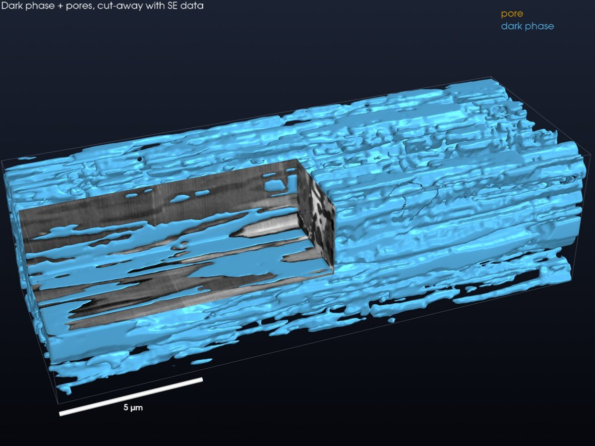
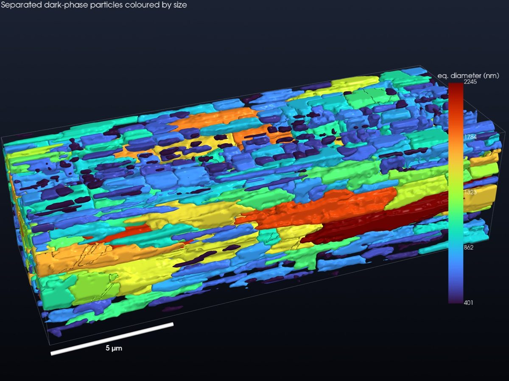
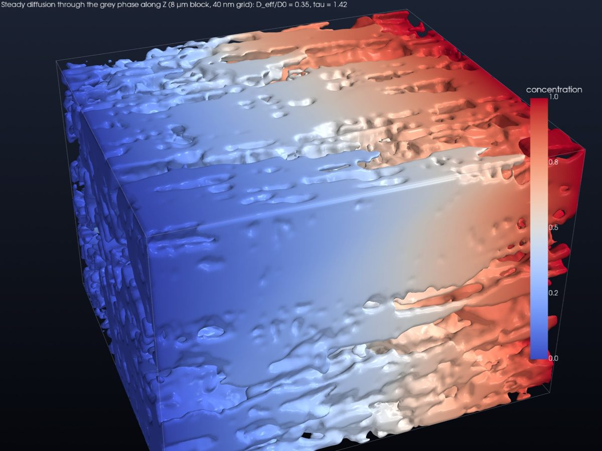
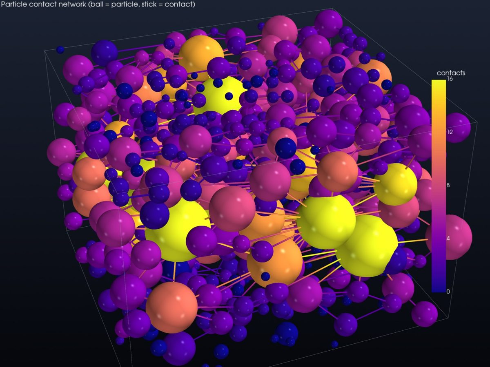

# NuScope-TOMO

**Open FIB-SEM slice-and-view tomography — from raw slices to quantified, chemically
resolved 3D microstructure.**

Created by **Roberto dos Reis ([@rmsreis](https://github.com/rmsreis))** · NUANCE Center,
Northwestern University · [NUANCE-IT/NUScope-TOMO](https://github.com/NUANCE-IT/NUScope-TOMO)

NuScope-TOMO is an open alternative to **Thermo Fisher Avizo** for FIB-SEM in materials
science. It covers import, pre-processing (with a guided FIB-SEM wizard), AI segmentation,
quantification, triple-phase boundaries, pore/particle networks, transport simulation,
visualization/animation and recipes. It also adds correlative EDS chemistry. Everything is
available as code, as reproducible YAML recipes and in a browser-based UI.
[PLAN.md](PLAN.md) maps each Avizo capability to its module.

<p>
  
  
</p>

*FIB-SEM sample 335 (812 slices, 20 × 5 × 5 nm voxels) processed by `examples/fib_sem_335.yaml`
in under 5 minutes: dark phase with a grey-value cut-away (left) and 1 414 separated particles
coloured by equivalent diameter (right).*

<p>
  
  
</p>

*Materials analyses: steady-state diffusion through the matrix phase (left, tortuosity factor 1.4
along Z, 3.8–3.9 across) and the contact network of the dark-phase particles (right, mean
coordination 3.0).*

| Stage | What you get |
|---|---|
| **Import** | TIFF/PNG folders (natural sort), multipage TIFF, Thermo Fisher pixel-size tags, streamed into chunked Zarr v3, so stacks larger than RAM are fine |
| **Pre-processing** | block-face auto-crop (Pt cap / trench / padding), multi-baseline drift solve with already-registered detection, wavelet–FFT curtain removal, shading flattening, slice brightness normalisation, NLM / TV / anisotropic 3D denoising, binning, isotropic resampling, 52° tilt calibration |
| **Segmentation** | Otsu / multi-Otsu / hysteresis, **random-forest classifier trained from a few scribbles** (41 multi-scale features), majority smoothing, watershed separation of touching particles |
| **Quantification** | per object: volume, surface area, equivalent diameter, sphericity, solidity, Feret, ellipsoid axes, elongation/flatness, orientation, nearest neighbour, intensity/element means. Per phase: volume fraction, specific surface, interface density, Euler number, percolation, geodesic tortuosity, continuous size distribution |
| **Materials analyses** | triple-phase boundary length density (total / active), steady-state diffusion & conduction solver (D_eff/D₀, tortuosity factor, MacMullin number; Avizo XLab counterpart), pore- and particle-network model (throat/contact sizes, coordination numbers) |
| **Beyond Avizo** | **data-health inspector** (per-slice SNR, sharpness, curtaining, drift, blank/duplicate slices, automatic slice-thickness check), **uncertainty on every number** (integral-range sampling error, ±1-voxel segmentation sensitivity, representative-volume size), **live acquisition mode** (`nuscope watch`: analyse while the FIB mills, tells you when precision is reached), **self-supervised Noise2Void** denoising and a **2.5D U-Net** trained from scribbles (Apple MPS / CUDA). See [docs/IDEAS.md](docs/IDEAS.md) |
| **Chemistry (EDS)** | element-map stacks → registration to SE → 3D composition → unsupervised chemical phases (k-means / GMM / NMF) → composition per SE phase or object; forward simulator for validation |
| **Visualization** | GPU renders (volume, phase surfaces with cut-away, objects coloured by any measurement), turntable MP4s, figure panels with true aspect and scale bars |
| **Studio** | browser UI: **FIB-SEM Wizard** (guided pre-processing, like Avizo's DualBeam 3D Wizard), linked XY/XZ/YZ views, WebGL2 ray-marched 3D (DVR / MIP / iso / labels, clipping), scribble annotation → train → segment, every operation as a form, sortable measurement tables. All actions are auto-recorded as a recipe |
| **Recipes** | YAML pipelines, `nuscope run`; every step logged with parameters, timings and library versions in `provenance.json` |

## Install

```bash
uv venv --python 3.12 && source .venv/bin/activate
uv pip install -e ".[dev]"          # add ",ai" for Noise2Void / U-Net (PyTorch)
```

## Use

```bash
nuscope run examples/fib_sem_335.yaml          # full pipeline on a slice-and-view stack
nuscope studio projects/fib_sem_335            # open http://127.0.0.1:8765
nuscope ops                                    # list operations and parameters
nuscope watch /acq/folder -p projects/run --voxel 20 5 5 --model rf.pkl   # live mode
python examples/beyond_avizo.py                # data health, Noise2Void, U-Net, RVE
python examples/showcase.py                    # figures, renders and animation
```

From Python:

```python
from nuscope_tomo import Volume
from nuscope_tomo.preprocess import auto_crop, align, destripe, denoise_nlm
from nuscope_tomo.segment import random_forest
from nuscope_tomo.analyze import measure_objects

vol = Volume.from_zarr("raw.zarr")
vol = denoise_nlm(destripe(align(auto_crop(vol))["volume"]))
phases = random_forest(vol, scribbles="annotations.json", classes=3)["volume"]
```

Remote use: run `nuscope studio --host 0.0.0.0` on the workstation that holds the data
and open it from any laptop. The browser only receives slices and a downsampled 3D preview.

## Design notes

- **Out-of-core first.** Volumes are Dask arrays over Zarr; slice-wise operations stream.
  Connected components, watershed and surface meshing run in memory, on a binned volume
  or an ROI for very large data.
- **Anisotropy everywhere.** FIB-SEM voxels are typically 5–10 nm in XY and 10–50 nm in
  Z. Distances, filters, surface areas and renders all use physical spacing.
- **Validated against ground truth.** `pytest` runs 20 tests on synthetic phantoms.
  They cover drift recovery, stripe removal, sphere volume, area and sphericity (within 1–2 %),
  percolation and tortuosity, random-forest accuracy, watershed splitting, TPB length on a
  straight triple line, transport through a straight channel (τ = 1, D_eff = ε), the neck of two
  fused spheres, slice-thickness detection, integral-range error prediction, Noise2Void,
  U-Net, live ingestion, EDS registration and phase recovery, the recipe engine and the
  Studio API.
- **Honest alignment.** Correlation cannot separate stage drift from microstructure that is
  inclined to the milling axis, which is especially a problem with thick slices. `align`
  therefore detects stacks that are already registered and leaves them alone, and supports
  fiducial ROIs and a high-pass drift model.

## Project layout

```
nuscope_tomo/
  core/        Volume, operation registry, recipes + provenance
  io/          slice import/export
  preprocess/  geometry, alignment, artifact correction, denoising
  segment/     thresholds, random-forest classifier, object separation
  analyze/     object morphometry, phase metrics
  chem/        EDS chemical tomography (+ simulator)
  viz/         GPU rendering, animation, figures
  studio/      FastAPI server + WebGL2 front-end
  cli.py       `nuscope` command
examples/      recipe for the sample dataset, showcase script
tests/         ground-truth tests
```

See [PLAN.md](PLAN.md) for the Avizo feature map and roadmap: U-Net segmentation, Noise2Void,
3D multi-volume registration, permeability, native `.h5oina` / `.bcf` EDS readers.

## Licence

MIT, see [LICENSE](LICENSE). Copyright (c) 2026 Roberto dos Reis (@rmsreis).

## Citation

If NuScope-TOMO helps your research, please cite it using [CITATION.cff](CITATION.cff).
Author: Roberto dos Reis (@rmsreis).
